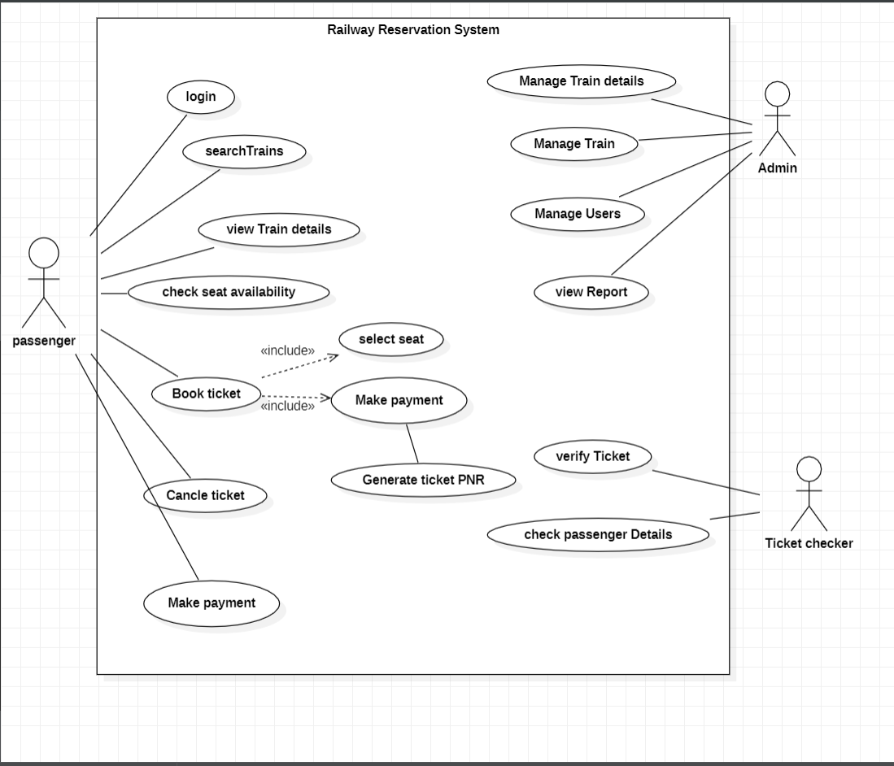
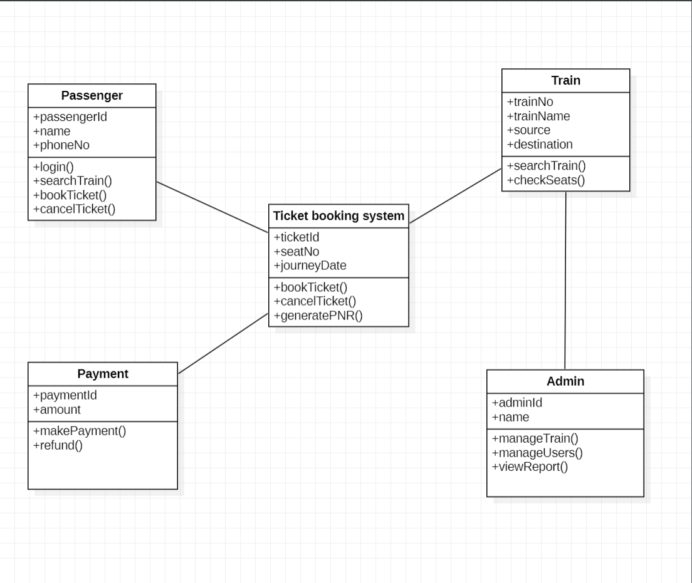
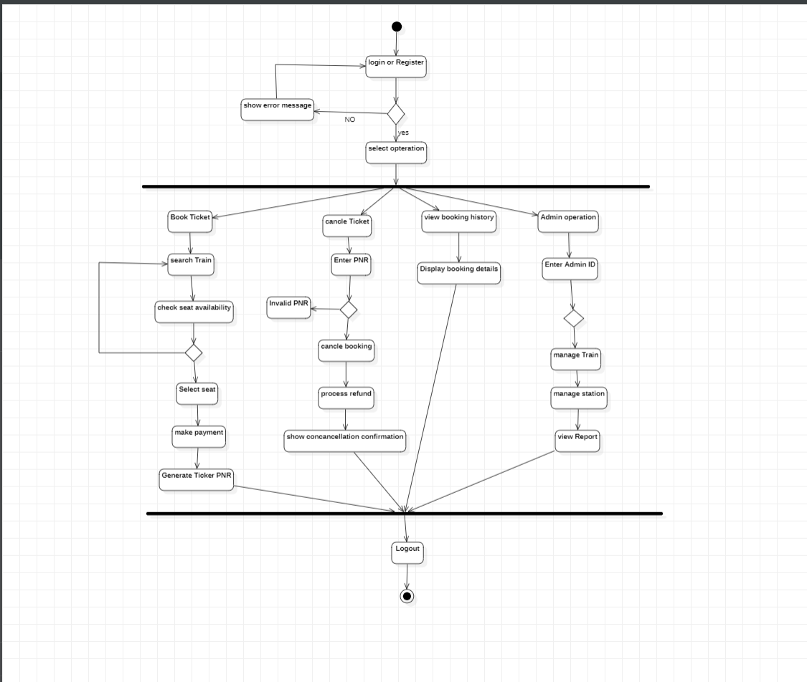
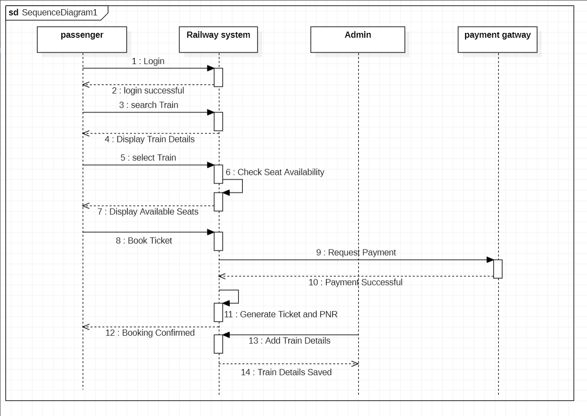
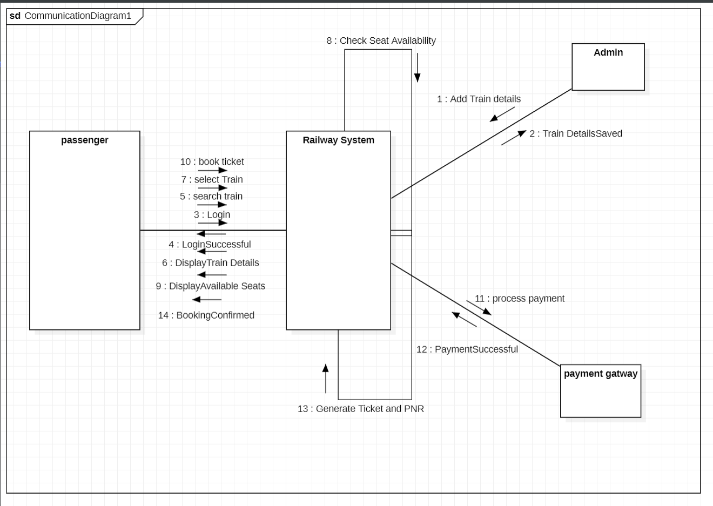
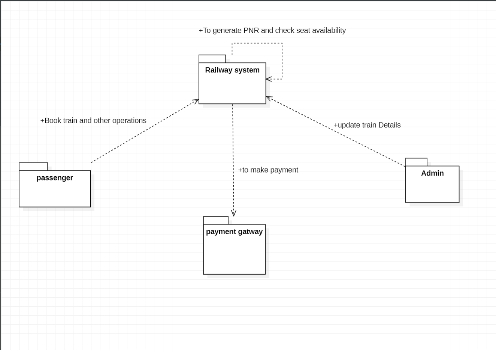

# EXP – 3: RAILWAY MANAGEMENT SYSTEM

## AIM:

To design and develop UML diagrams for a Railway Management System to represent its structure, functions, and interactions between the passenger, admin, TTE, and railway system.

## SRS (Procedure):

### Step 1: Problem Identification

The main problem is the difficulty of manually managing train schedules, passenger details, ticket bookings, seat availability, and cancellations. A Railway Management System helps automate these activities efficiently.

### Step 2: Requirement Analysis

Identify the main users: Passenger, Admin, and TTE (Ticket Checker).

**Functional Requirements:**

1. Passenger login and registration.
2. Search trains and check seat availability.
3. Book railway tickets.
4. Make payments and generate tickets with PNR numbers.
5. Cancel tickets and process refunds.
6. Admin manages train details and schedules.
7. TTE verifies passenger tickets.

**Non-Functional Requirements:**

1. Security
2. Reliability
3. Accuracy
4. User-friendliness
5. Fast response time

### Step 3: System Design

Draw the following UML diagrams to represent the system:

1. Use Case Diagram
2. Class Diagram
3. Activity Diagram
4. Sequence Diagram
5. Communication Diagram
6. Package Diagram

# DIAGRAMS:

## Use Case Diagram

## Class Diagram

## Activity Diagram

## Sequence Diagram

## Communication Diagram

## Package Diagram

# RESULT:

Thus, the six UML diagrams for the Railway Management System were designed successfully to represent its structure, functionality, and interactions between the passenger, admin, TTE, and railway system.
